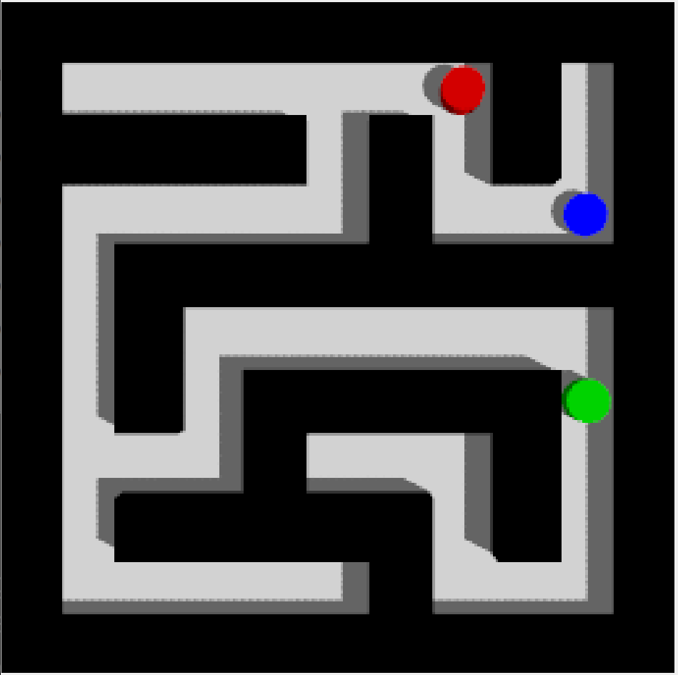
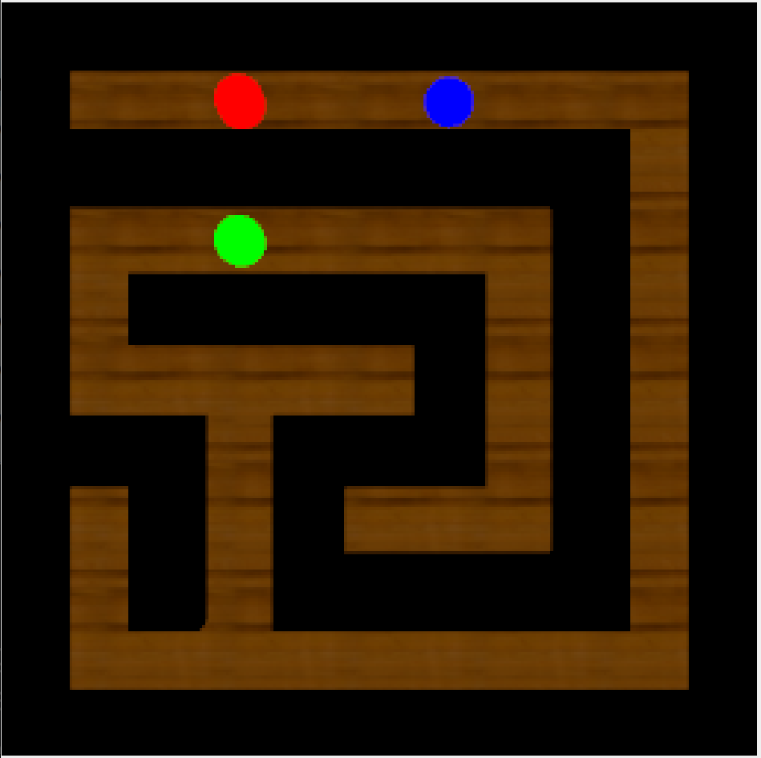
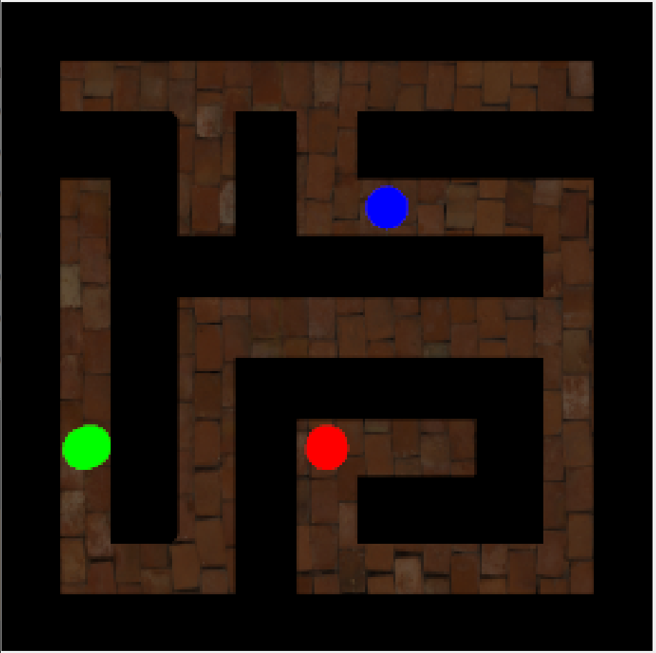
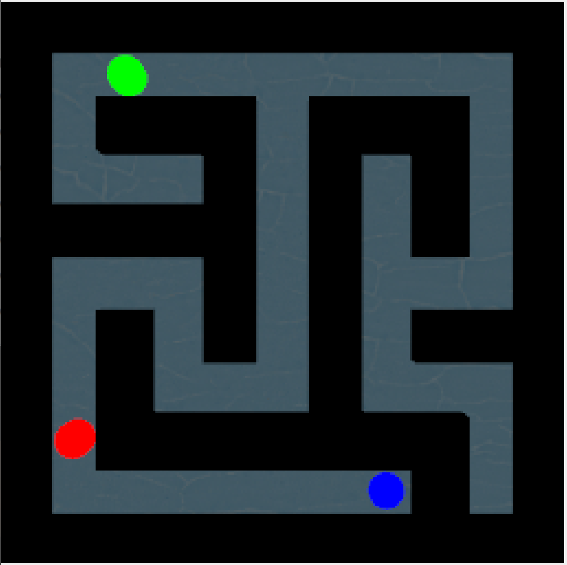
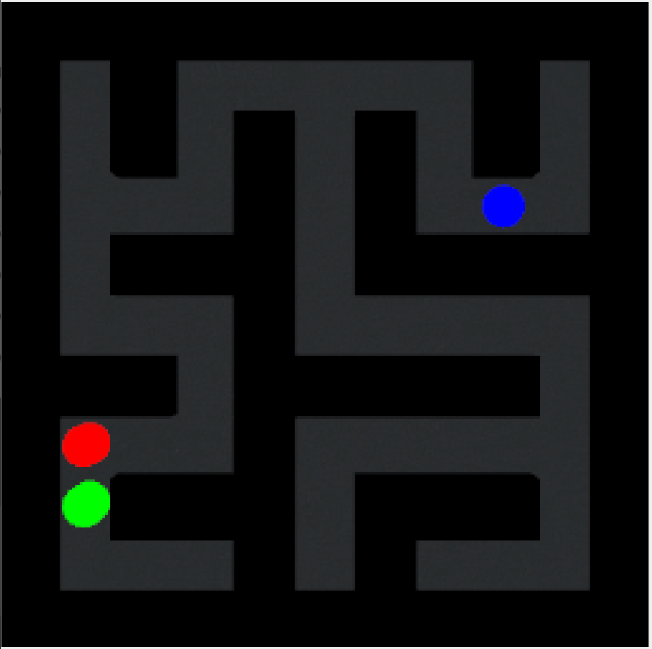

# Deploying a Language-Conditioned Vision-Language-Action Policy into a Physics Simulator

**Course project, Cognitive Robotics**
Pranav  23BRS1435
Anurag 23BAI1056
Rahul 23BRS1316

---

## Abstract

This project has two stages. In the first, a Vision-Language-Action (VLA)
policy was built and trained to solve procedurally generated mazes from
free-text instructions, reaching 96 to 99 percent on unseen layouts and 99.2
percent across sixteen instruction phrasings it had never seen, with
essentially no wrong-goal selections. That policy learns entirely from flat,
synthetically rendered 2D images in which every pixel is one of five exact
colours.

The second stage, and the subject of most of this report, deploys that policy
unchanged into a ROS 2 and Gazebo simulation, where the same mazes are built
from physical geometry, observed through a simulated camera, and navigated by
a differential-drive robot under rigid-body physics. The weights are frozen
throughout, so that the deployment gap is measured against a fixed reference
rather than moving both halves of the comparison at once.

The central question is therefore not whether a better policy can be learned,
but whether a policy that performs near-perfectly in its own renderer survives
a change in how its observations are produced. We report a working end-to-end
system, a catalogue of the integration faults that had to be fixed before the
policy could act at all, an initial study of how behaviour degrades when the
rendered scene is perturbed, and a lightweight input-conditioning filter that
recovers behaviour under several perturbations, including a characterisation
of where that filter itself fails.

---

## 1. Introduction

The policy consumes a 64x64 RGB top-down image of a maze and a free-text
instruction, and emits one of four discrete actions (up, down, left, right).
Section 3 covers its architecture, training, and results in full; what matters
for the deployment question is the nature of the images it learned from.

In the training environment, observations are drawn directly into a numpy array:
walls are exactly black, floor exactly white, goals exactly red and green, and
the agent exactly blue. Every pixel is one of five values. Nothing is shaded,
occluded, blurred, or noisy.

Deployment into Gazebo replaces that renderer with a camera sensor observing
lit, textured, physically sized geometry. The policy's input is nominally the
same shape and nominally the same scene, but is produced by an entirely
different process. This is a small, controlled instance of the sim-to-real
transfer problem, with the convenient property that the "source" domain is
fully reproducible and the gap can be widened deliberately and measured.

---

## 2. Related Work

The literature below situates the transfer problem and the specific failure
modes observed, rather than establishing novelty against competing systems.
This project does not propose a new architecture, training method, or
benchmark; it reuses standard components (CLIP for language encoding,
behaviour cloning against an A* expert, ROS 2 and Gazebo for deployment) and
reports what happens when an already-trained instance of this general
approach is moved into a higher-fidelity renderer.

**Vision-language-conditioned policies.** The policy's language pathway is a
frozen CLIP text encoder (Radford et al., 2021), the same component CLIPort
(Shridhar, Manuelli, and Fox, 2021) uses to condition a manipulation policy on
free-text instructions without fine-tuning the language model. The present
work is architecturally closer to CLIPort than to the systems usually cited
for language-guided navigation specifically, such as the Room-to-Room
benchmark introduced by Anderson et al. (2018) for grounding natural-language
instructions in real building interiors: that line of work targets
photorealistic, variable real-world scenes and sequence-to-sequence
instruction following, whereas the setting here is a single short instruction
selecting between two fixed goal identities in a procedurally generated but
visually simple maze. The term vision-language-action itself, used throughout
this report, is adopted from the RT-1 and RT-2 line of work (Google DeepMind),
which conditions robot action generation directly on paired image and
language input at much larger scale; the policy here is the same shape of
model trained on an incomparably narrower and more controlled task, which is
precisely what makes the deployment gap tractable to isolate and measure in
the first place.

**Imitation learning and compounding error.** The behaviour-cloned policy, and
the PPO fine-tuning stage described in Section 3.2 that was built to address a
weakness in it, both sit on top of a well-known property of imitation learning:
a policy trained on expert state visitation can drift into states the expert
never demonstrated recovery from, and small per-step errors compound rather
than average out. Ross, Gordon, and Bagnell (2011) give the formal account of
this failure and the DAgger algorithm as one correction, by querying the
expert on states the learned policy itself visits rather than only on the
original demonstration trajectories. This project does not implement DAgger or
any of its variants; the relevance is diagnostic rather than constructive. The
livelock failure mode characterised in Section 6.5, where the policy repeats a
single blocked action forever because the resulting observation is unchanged,
is exactly the kind of self-compounding error this literature describes, and
recognising it as such is what motivates treating dataset scale and
fine-tuning as a mitigation that was measured to suppress the failure
in-distribution (Section 3.2) rather than one that was ever shown to remove it.

**Sim-to-real and domain gap.** The failure mode studied in Section 6 is the
standard one in transfer: a policy trained on one observation distribution
degrades when the observation process changes, even when the underlying task
is identical. Domain randomisation (Tobin, Fong, Ray, Schneider, Zaremba, and
Abbeel, 2017) addresses this at training time by deliberately randomising
textures, lighting, and camera parameters in the simulator, so that the real
world appears to the trained model as just another sampled variation; their
result, a real-world object detector trained only on non-photorealistic
randomised simulation images, is the canonical demonstration that the
randomisation axes matter more than photorealism. The situation studied here is
the complementary one: the policy is already frozen, so randomisation at
training time is no longer available, and the only remaining levers are on the
deployment side, either matching the renderer to the training distribution or
conditioning the observation before it reaches the policy. The perturbation
sweep in Section 6 is, in effect, a post-hoc measurement of how much
randomisation along each axis (lighting, sensor noise, floor appearance) the
policy would have needed to have seen during training to be robust to it at
deployment, asked after the fact rather than designed in beforehand.

**Learned policies in ROS and Gazebo.** Deploying a policy trained in a fast,
abstract environment into a higher-fidelity physics simulator before any real
hardware is a common staging pattern in robotics practice, supported here by
ROS 2 as the inter-process messaging layer and Gazebo as the physics and
sensor simulator. The practical content of that staging step, which is usually
omitted from papers reporting the policy side of a project, turns out to be
most of the engineering effort, and is reported in full in Section 5.

---

## 3. The Policy and Its Training-Environment Results

The agent deployed in Section 4 was built and trained as the first stage of
this project. This section records what it is and how it performs in its own
environment, which is the reference point every later measurement is compared
against.

### 3.1 Architecture

The model takes a 64x64 RGB top-down image and a free-text instruction, and
emits one of four discrete actions. Vision is split across two separately
pretrained convolutional backbones:

- an **entity CNN**, pretrained to regress agent and goal positions, and
- a **wall CNN**, pretrained to encode corridor and wall structure.

Their outputs are concatenated, passed through a visual adapter of
convolutional and residual blocks, and flattened into 64 spatial patch tokens
with 2D positional embeddings. The instruction is encoded by a frozen CLIP
ViT-B/32 text encoder and projected to four language tokens. Patch tokens
cross-attend to those language tokens, then pass through self-attention and
attention pooling into separate action and value heads.

Splitting the visual stream was the single most important architectural
decision. Visualising the two backbones shows a clean division of labour: the
entity CNN produces sparse, near-blank maps with a single hot activation at
each entity, while the wall CNN produces dense maps that trace corridors and
boundaries. Without the explicit wall stream the policy had no representation
of which moves were passable, and generalisation across layouts was poor.

### 3.2 Training

Training is behaviour cloning against an A* expert on more than 12,000
procedurally generated mazes. No reinforcement learning is used in the final
system.

A PPO fine-tuning stage was implemented earlier, aimed at a known weakness of
pure imitation learning: compounding error at ambiguous decision points, where
a deterministic policy can oscillate between two equally plausible moves. It
raised greedy solve rate on a smaller dataset from 33% to 40%, though it was
not isolated whether that gain came from resolving oscillation specifically.
Once the behaviour-cloning dataset was scaled past 12,000 diverse layouts the
base policy reached 96 to 99% unaided, and the fine-tuning stage no longer
earned its complexity, so it was dropped. The useful lesson was that dataset
diversity mattered considerably more than the RL stage.

### 3.3 Results in the training environment

| Metric | Value |
|---|---|
| Behaviour cloning train accuracy | 99% |
| Behaviour cloning validation accuracy (held-out mazes) | 99% |
| Rollout solve rate, unseen mazes, greedy | 96 to 99% (3 independent 100-maze trials) |
| Wrong-goal rate | approximately 0% |
| Instruction generalisation (16 novel phrasings, 480 episodes) | 99.2% average solve rate, 0 wrong-goal selections |

Zero-shot language generalisation is the notable result. The policy was
trained only on the sentences "navigate to the red goal" and "navigate to the
green goal", yet follows unseen phrasings without any retraining. Across eight
held-out phrasings per colour it solved 30 of 30 on most and 29 of 30 on the
weakest, and never selected the wrong goal. Phrasings such as "crimson",
"blood coloured target", "grass coloured target" and "leafy target" work
because the frozen CLIP encoder already places them near "red" or "green" in
embedding space, and cross-attention keys off that semantic direction rather
than memorising literal training strings.

### 3.4 Known limitations of the policy

Two limitations carry forward into deployment and are not addressed by this
work.

**Negation is not supported.** Given "don't go to the red goal" the agent
still navigates to red. CLIP's contrastive objective provides no mechanism for
negation, so "not red" sits close to "red" rather than opposite it. Because
the language pathway is frozen, this is inherited rather than fixable with
more data.

**Scope is narrow.** The policy was trained and evaluated only on 5x5
procedurally generated mazes with exactly two goal colours. Larger mazes or
additional colours are untested, and the deployment in Section 4 preserves the
same 5x5 setting for that reason.

---

## 4. Method

### 4.1 System architecture

Five ROS 2 nodes run alongside a Gazebo world:

| Node | Role |
|---|---|
| `overhead_camera` (Gazebo sensor) | top-down camera over the maze |
| `image_to_maze` | downsamples to 64x64, optionally conditions the image |
| `vla_inference` | CLIP text encoding plus policy forward pass, emits an action |
| `motion_controller` | converts a discrete action into closed-loop motion |
| `maze_manager` | generates mazes, spawns geometry, drives episode resets |

The maze itself is not static world geometry. `maze_manager` holds an instance
of the original training environment, calls its generator to obtain an 11x11
occupancy grid, and spawns one Gazebo model per wall cell plus a floor and two
coloured goal cylinders. This guarantees that the mazes seen in simulation come
from exactly the same distribution the policy was trained on.

### 4.2 Coordinate conventions

The policy reasons in image space. A single mapping ties that to the world:
grid cell `(row, col)` maps to world `(x, y) = (col, -row)`, and the overhead
camera is oriented so that image-right is world `+x` and image-up is world `+y`.
Under that convention the four actions correspond to absolute world headings of
`+pi/2`, `-pi/2`, `pi`, and `0`. Every piece of geometry, the robot's start
pose, and the motion controller's targets are all derived from that one mapping,
so the policy's notion of "up" and the simulator's notion of "up" cannot drift
apart.

### 4.3 Motion control

Each action is executed as one discrete grid step, mirroring the semantics of
the training environment's `step()`:

1. Round the robot's current pose to the nearest integer cell centre.
2. Rotate in place to the action's absolute heading.
3. Drive to the adjacent cell centre, steering continuously to correct lateral
   error.
4. If the move stalls against a wall, return to the starting cell centre and
   leave the policy to choose again, matching the training environment, which
   leaves the agent in place on a wall collision.

Targeting absolute cell centres rather than driving a fixed distance is
important. Open-loop "drive one metre forward" accumulates heading and stopping
error on every step, and after roughly ten moves the robot is far enough
off-centre to clip wall corners and to present the policy with an agent position
it never saw in training.

Pose feedback is taken from Gazebo's ground-truth pose publisher rather than
from wheel odometry. Wheel odometry is dead reckoned, so it does not follow the
teleport that `maze_manager` performs at every episode reset, and the two frames
diverge permanently after the first reset.

### 4.4 Episode lifecycle

An episode ends when the robot reaches either goal or exceeds 200 steps, which
matches the training environment's termination conditions. `motion_controller`
publishes `/episode_done`; `maze_manager` pauses physics, despawns the old maze,
generates and spawns a new one, teleports the robot to the new start cell,
unpauses, and only then publishes the new goal positions. Publishing goals last
makes their arrival the signal that the episode is fully constructed, and
`motion_controller` ignores actions in the interval between episodes. Pausing
during the rebuild prevents the policy from being fed a half-built scene.

The robot does not move until an instruction is published on `/instruction`.
Instructions may be reissued mid-episode to retarget the agent live.

---

## 5. Integration Findings

Before any evaluation was possible, several faults had to be found and fixed.
These are reported because they constitute most of the engineering content of
the project, and because several of them presented as apparent policy failures.

**Inverted actuation.** Both wheel links are rolled 90 degrees, which left their
joint axes pointing along world `-y`. Positive wheel velocity therefore drove
the robot backwards, and because odometry is integrated from those same joints,
the odometry was mirrored to match. The system was internally self-consistent
and therefore looked correct in isolation, while every commanded direction was
reversed. This was the root cause of a family of symptoms that had previously
been attributed to the camera orientation and to the action mapping.

**Camera frame alignment.** The overhead camera's image axes did not initially
agree with the world axes. This was diagnosed by driving each of the four
actions directly, with the policy removed from the loop entirely, and observing
the resulting motion in the camera image.

**Apparent scale.** The bare 0.3m by 0.2m chassis subtends roughly one pixel in
the 64x64 observation. The training renderer draws the agent as a filled circle
of diameter about 0.7 cell widths. A visual-only marker disc of matching
proportion was added above the chassis, and the camera field of view was
narrowed so that the 11x11 grid exactly fills the frame, as it does in training.

**Reset races.** Teleporting the robot while an action was still executing
produced moves that appeared to travel more than a full cell. Spawning roughly
twenty models per reset through a ROS node per model was also slow enough to
make Gazebo's creation service unreliable. Both were resolved by pausing physics
across the rebuild, calling the Gazebo service directly, and gating actions
between episodes.

**Concurrent control.** The action and pose callbacks initially shared one
reentrant callback group under a multi-threaded executor. Two queued actions
could therefore pass an unguarded `busy` check simultaneously and execute two
moves at once, with both threads publishing conflicting velocity commands. The
action callback was moved to a mutually exclusive group, and its queue depth
reduced to one so that a freed controller acts on the newest action rather than
a stale queued one.

**Wall-clock versus simulation time.** All controller deadlines were measured
with the wall clock while physics advanced on simulation time. When the
real-time factor fell below one, which happened reproducibly when the host
laptop was running on battery, the robot covered less ground per real second
while the deadlines continued at full speed. The no-progress stall detector was
the most sensitive: acceleration limits mean the first fraction of a second of
each move is a ramp-up, so a shortened effective window caused moves to be
declared blocked while the robot was still accelerating. The controller then
reversed to the cell centre, producing oscillation. The simulation clock is now
bridged and the controller reasons in simulation time, with a generous
wall-clock backstop retained only to prevent a hang if the clock stops.

A recurring methodological lesson: motion was verified in isolation, with no
policy and no camera, against ground-truth pose, before any perception-level
explanation was accepted. Several hours were lost early on to perception
hypotheses for what were actuation faults.

---

## 6. Perception Robustness Study

### 6.1 Baseline

Before any deployment measurement, the policy was re-verified standalone,
outside ROS, using the exact checkpoint the deployed node loads. It solved 6 of
6 episodes across both target colours, consistent with the 96 to 99 percent in
Section 3.3. This matters procedurally: it fixes the checkpoint as a known-good
reference, so any subsequent failure in simulation is attributable to the
deployment pipeline rather than to the weights.

Measuring the deployed observation against the training palette, 88.2 percent of
pixels fall within a distance of 30 from one of the five training colours, and
8.9 percent are clearly off-palette. The residual is concentrated at
antialiased boundaries between wall and floor, which have no analogue in the
training renderer.

### 6.2 Perturbations

Four conditions are available as launch-time variants, applied one at a time:

| Condition | Mechanism |
|---|---|
| Baseline | shadows disabled, emissive flat materials |
| Shadows | shadow casting enabled |
| Off-angle light | sun lowered to about 46 degrees elevation |
| Camera noise | Gaussian noise on the camera sensor |
| Floor texture | a tiled image replaces the flat white floor |

Two design details were necessary for these to mean anything. First, the flat
materials used to keep the baseline close to the training palette are emissive,
which makes them immune to lighting by construction; a shadow condition applied
on top of emissive materials produced no measurable change whatsoever, and the
materials had to be made light-responsive for the sweep to register. Second, an
initial off-angle configuration placed the sun at about 18 degrees elevation,
which, against 0.5m walls, casts shadows over 1.5m long. These blanketed almost
the entire floor, and the resulting observation carried essentially no usable
structure. That condition was not a robustness test but an information-destroying
one, and the elevation was raised until shadow length was about half a cell.

**Figure 1.** The scene as actually rendered under six of the conditions
measured in Section 6.4, before any conditioning is applied. These are the
full-colour overhead view, not the thresholded observation the policy
receives when conditioning is enabled; they illustrate what the conditioning
filter has to work with, not what it outputs.

| Baseline | Shadows |
|---|---|
|  |  |

| Wood | Brick |
|---|---|
|  |  |

| Blue tile | Concrete |
|---|---|
|  |  |

The concrete image is worth looking at directly against the others. Wood and
brick both carry clearly visible, high-frequency grain and seams; concrete
renders as a nearly uniform dark slate colour with almost no visible texture
at all. This is consistent with the mechanism established in Section 6.4: the
problem with concrete is not pattern complexity confusing the classifier, it
is that the floor is simply dark enough to sit close to the wall threshold,
and the image supports that reading directly.

### 6.3 Qualitative findings

Under strong shadows, and with no input conditioning, the policy collapses to
emitting a single action repeatedly. This is consistent with the shadowed floor
being read as wall: the wall encoder was trained on a strictly binary
wall-versus-floor image, and a shadow introduces intermediate values that have
no training analogue.

With input conditioning enabled (Section 7), the policy solves mazes under the
shadow condition. Qualitatively it oscillates near turns more often than it does
in the pure training environment, which remains an open item.

### 6.4 Measured results so far

Episodes are run manually: an instruction is published, the episode is watched
through to its end, and the outcome is recorded as reaching the correct goal,
reaching the wrong goal, exhausting the step budget, or livelocking (defined in
Section 6.5). The node reports which goal was actually reached, so correct-goal
and wrong-goal terminations are distinguished rather than both counting as a
solve.

| Condition | Conditioning | Solved | Target split | Oscillation |
|---|---|---|---|---|
| Baseline | off | 6 of 6 | 3 red, 3 green | none observed |
| Shadows | on | 6 of 6 | 3 red, 3 green | none observed |
| Camera noise | off | 6 of 7 | 4 red, 3 green | 1 (green) |
| Wood texture | on | 5 of 6 | 3 red, 3 green | 1 ( green) |
| Brick texture | on | 6 of 6 | 3 red, 3 green | none observed |
| Blue tile texture | on | 5 of 6 | 3 red, 3 green | none observed |
| Concrete texture | on | 2 of 6 | 3 red, 3 green | 4 (2 red, 2 green) |

Step counts were recorded for the shadow, noise, wood, brick, blue tile, and
concrete conditions (shadows: red 8, 20, 22, green 15, 11, 22, mean 16.3;
noise: red 9, 15, 7, 20, green 15, 19, mean 14.2; wood: red 22, 8, 34, green
11, 34, mean 21.8 over the five solved episodes; brick: red 21, 18, 9, green
11, 15, 17, mean 15.2; blue tile: red 6, 9, 11, green 21, 10, mean 11.4 over
the five solved episodes; concrete: red 7, green 10, mean 8.5 over the two
solved episodes) but are not treated as a metric. The generator usually admits
only one route to a given goal, so step count is largely a property of the
maze rather than of the policy. The noise run split 4 red to 3 green rather
than evenly; all four red episodes solved, and one of the three green episodes
livelocked. The wood run was even at 3 and 3; all three red episodes solved,
and one of the three green episodes livelocked. The brick run was also even at
3 and 3, and every episode solved. The blue tile run was even at 3 and 3; all
three red episodes solved, and one of the three green episodes livelocked. The
concrete run was even at 3 and 3, and livelocked on two of three red episodes
and two of three green episodes.

Seven results follow. First, on a clean render the deployed policy matches its
training-time behaviour, so the integration itself is not the bottleneck.
Second, shadows with input conditioning enabled cost nothing in solve rate.
Third, Gaussian camera noise costs almost nothing even with conditioning
disabled, which is the one condition so far that isolates the policy's own
tolerance from the filter's effect: the raw, unconditioned observation under
noise is close enough to the training distribution that the frozen policy
handles it directly. Fourth, a wood floor texture with conditioning enabled
costs one livelock out of six, the same single-episode cost seen on noise,
despite wood being a considerably larger perturbation to the raw image than
either shadows or noise. Fifth, and most directly validating the conditioning
design, a brick floor with conditioning enabled costs nothing at all. This is
the texture whose unconditioned failure mode was characterised in Section 7:
without the hue and size checks, brick's red-adjacent hue caused 79.3 percent
of the floor to be classified as the red goal, which would be expected to
devastate navigation toward either target, red most directly. The clean 6 of 6
here is the first result that exercises the fix on the exact failure it was
built for, rather than on a perturbation the filter was not specifically
designed against. Sixth, a blue floor tile with conditioning enabled costs one
livelock out of six, matching wood and noise. Seventh, and the one result that
breaks the pattern of the other five, a concrete floor with conditioning
enabled costs four livelocks out of six, by a wide margin the worst result
measured.

The concrete result has a confirmed mechanism, found by inspecting the actual
`/maze_obs_thresholded` output live rather than relying on the static-file test
alone. Static-file testing of the conditioning filter against the concrete
texture, at the resolution and resize method the deployed pipeline actually
uses, shows it thresholding cleanly to 100 percent floor on the open texture
away from any wall. What the live feed shows, and what the static test could
not have caught, is that this cleanliness does not hold at wall boundaries.
Concrete's rendered brightness is low, with channel values in the high 60s to
high 70s against a wall threshold of 40, a narrower margin than for any other
texture tested. At a true wall edge the antialiased transition pixels blend
concrete's already-dark floor colour toward the wall's black, and that blend
crosses the wall threshold unevenly from pixel to pixel, so a wall silhouette
that is a single straight line in training renders as a ragged, broken edge in
the thresholded observation. The open floor is unaffected; the wall boundaries
are not. This is consistent with the livelock mechanism in Section 6.5: a wall
CNN trained exclusively on straight synthetic edges has no reason to localise
a corridor boundary correctly when the boundary itself is corrupted, and a
confidently wrong read of where a wall is produces exactly the kind of
repeated blocked move that becomes a permanent loop under greedy action
selection.

The blue tile result is a different kind of hue collision from brick's, worth
distinguishing rather than grouping with it. Brick's hue lands on a goal
colour, so an unconditioned misclassification would scatter false goal signal
across the floor. Blue tile's hue lands on the agent colour, so the equivalent
failure would be false self-localisation signal: the entity CNN was trained to
treat a blue blob as a dense, unambiguous marker of the robot's own position,
and a floor full of blue-classified patches has no analogue in training at
all. That the filter still reduces this to a single livelock out of six, the
same cost as wood, suggests the hue and size checks generalise across both
failure types rather than being tuned narrowly to the red case, though the
small sample size (Section 9) limits how much weight that comparison can
bear.

The shadow result is reported as a property of the deployed configuration
rather than of the policy alone. It differs from the earlier collapse in
Section 6.3 along two axes at once: that collapse was unconditioned and under
the original off-angle light, whose shadows exceeded a full cell, whereas the
measured condition is conditioned and uses the retuned half-cell light. The
unconditioned arm of this condition was not run, so the result establishes
that the pipeline as deployed handles moderate shadows, not that either the
policy or the filter does so independently. The wood result shares this same
ambiguity: it was also measured conditioned, so it speaks to the pipeline as a
whole rather than crediting the policy or the filter specifically. Noise is
the only condition without this ambiguity, since it was measured unconditioned.

Off-angle light remains unmeasured. The conditioning-on versus
conditioning-off comparison was not run per perturbation, but every condition
in this sweep was run with conditioning enabled except camera noise, and a
separate check confirmed that the raw, unconditioned pipeline fails broadly
rather than only under the strong-shadow case in Section 6.3: with
conditioning off, deployment does not survive the perturbations tested here.
Conditioning was therefore treated as a precondition for a usable result
across the sweep rather than as an independent variable to test per
perturbation, with noise as the one deliberate exception, used specifically
because there was reason to expect the raw pipeline might survive it, which it
did.

### 6.5 Livelock as a distinct failure mode

Action selection is a greedy argmax, and a blocked move leaves the robot
exactly where it started, so the next observation is byte-identical to the
previous one and the policy necessarily selects the same action again. A
single blocked choice is therefore not a recoverable error but a permanent
loop. This is a property of the policy, not of the controller: logs confirm
the controller stops the robot against the wall at precisely the geometrically
predicted distance and returns it to the cell centre each time.

One observed instance is diagnostic. The robot sat at cell (3, -9) and the
policy commanded a move to (3, -10), which is the outer border of the grid and
therefore always wall. It stalled 0.66m short of target on seven consecutive
attempts. A wall block centred on the adjacent cell presents its face 0.5m from
the robot's starting centre, and the chassis is 0.3m long, so contact occurs
after 0.35m of travel, leaving 0.65m. The measurement matches the geometry to
the centimetre.

The same mechanism exists in the training environment, where a blocked move is
also a no-op. It rarely matters there because the policy almost never selects a
blocked move in distribution. Livelock rate is therefore a sharp measure of the
domain gap: it is close to the rate at which the deployed observation misleads
the policy about wall structure.

The root cause is not established. The one instance diagnosed in detail is the
border-wall case above, where the policy repeatedly commanded a move into a
wall, which is consistent with a failure to perceive wall structure rather
than with indecision between two viable moves. Other observed episodes
flip-flop between two adjacent cells, which could be either. Separating these
would require logging the action distribution rather than only the selected
action: a near-tie between two actions indicates ambiguity, while a confident
choice of a blocked direction indicates the observation is being misread.
That instrumentation does not exist yet.

A superficially similar phenomenon is noted in the training stage (Section
3.2), where deterministic policies can oscillate at ambiguous decision points.
No claim is made here that the two share a mechanism. The training-stage PPO
experiment was never shown to resolve oscillation in the procedural
environment; it raised greedy solve rate on a smaller dataset and was dropped
once behaviour cloning alone proved sufficient, so it provides no evidence
about the deployment case either way.

One remedy is available independent of the cause. The loop is terminal only
because action selection is greedy, so a blocked or looping choice repeats
forever. Stochastic sampling, which the training-stage code already supports,
would make such a loop escapable without touching the weights. That addresses
the determinism rather than whatever is producing the bad action in the first
place.

---

## 7. Input Conditioning

Since the policy is frozen, the only available intervention is on its input. We
map each observed pixel back onto the five-colour training palette before the
policy sees it. The final rule is:

1. If every channel is below a threshold, classify as wall.
2. Otherwise, if chroma (the spread between the largest and smallest channel) is
   low, classify as floor. This catches shadowed floor regardless of how dark
   the shadow is.
3. Otherwise, classify by **hue**, accepting only hues within a tight window of
   the three entity hues, and classify everything else as floor.
4. Finally, revert any entity-coloured connected region far larger than a goal
   or agent blob back to floor.

Steps 3 and 4 were each forced by a concrete failure, and the path to them is
worth recording because the obvious implementations are wrong.

**Nearest-colour matching is wrong.** A dark grey shadow pixel such as
(40, 40, 40) is numerically closer to pure red (255, 0, 0) than to white
(255, 255, 255), because reaching white requires moving all three channels while
reaching red requires moving only two. A naive nearest-palette snap therefore
turns shadows red.

**Dominant-channel classification is wrong.** Classifying a saturated pixel by
whichever channel is largest turns a wood-textured floor entirely red, because
brown has a red-dominant channel ordering. Measured on the wood texture, 100
percent of the floor was classified as the red goal, which is strictly worse
than no conditioning at all: the policy would see the entire floor as its target.

**Hue is the correct invariant.** Darkening a pixel scales all channels
together and therefore does not rotate its hue. Measured directly, the goal and
agent colours sit at exactly hue 0, 60, and 120 whether at full brightness or
heavily shadowed, while the wood texture sits at hue 16. Classifying on hue, with
a tolerance of 8 units on OpenCV's 0 to 179 scale, accepts every shadowed entity
and rejects wood entirely.

**Hue alone is still insufficient.** A brick texture is genuinely red: its hue
clusters between 9 and 14, immediately adjacent to the red goal's hue of 0. No
per-pixel colour rule can separate a red brick floor from a red goal marker,
because they are the same colour. What separates them is extent. A goal or agent
occupies about 13 pixels in the 64x64 frame, while a textured floor occupies
thousands. Adding a connected-component size filter reduced brick's false-red
coverage from 79.3 percent to 0.5 percent, and tightening the hue tolerance to 8
removed the remainder. The size filter is retained as a second line of defence,
since it is the only mechanism that would catch a future texture whose hue lands
exactly on an entity colour.

Verified behaviour of the final rule, measured directly on the texture files and
on synthetic scenes:

| Input | Result |
|---|---|
| wood, brick, blue tile, concrete, checker textures | 100 percent floor |
| goal and agent blobs on any of those textures | all three preserved |
| shadow-darkened goal and agent blobs | all three preserved |
| clean scene with Gaussian sensor noise | all three preserved |

This conditioning is honestly characterised as a deployment-side patch, not a
general solution. It encodes specific knowledge of the training palette and of
the expected size of entities. Its value is that it is cheap, requires no
retraining, and makes explicit exactly which assumptions the frozen policy
depends on.

---

## 8. Evaluation Design

There is no competing system to compare against, because the contribution is an
integration rather than an algorithm. The appropriate comparison is the policy
against itself across conditions, which isolates the effect of the observation
process while holding the policy fixed:

| Condition | Conditioning | Purpose | Result |
|---|---|---|---|
| Training renderer | n/a | upper bound | 6 of 6 (3 red, 3 green) |
| Simulation, baseline | off | cost of integration alone | 6 of 6 (3 red, 3 green) |
| Simulation, shadows | on | shadow perturbation with the filter on | 6 of 6 (3 red, 3 green) |
| Simulation, camera noise | off | isolates the policy's own tolerance to noise | 6 of 7 (4 red, 3 green) |
| Simulation, wood texture | on | floor texture perturbation with the filter on | 5 of 6 (3 red, 3 green) |
| Simulation, brick texture | on | the texture the filter was specifically built for | 6 of 6 (3 red, 3 green) |
| Simulation, blue tile texture | on | hue collision with the agent colour rather than a goal | 5 of 6 (3 red, 3 green) |
| Simulation, concrete texture | on | thresholds cleanly offline, yet the worst result measured | 2 of 6 (3 red, 3 green) |
| Simulation, off-angle light | - | remaining perturbation | not yet measured |

The baseline row is the first evidence that the integration itself is not the
bottleneck: on a clean render the deployed policy matches its training-time
behaviour. The noise row shows that the raw, unconditioned policy already
tolerates Gaussian sensor noise with only one livelock in seven episodes. The
shadow, wood, and blue tile rows show nearly no cost from those perturbations,
but with the conditioning filter active in all three, so unlike noise they do
not isolate whether the policy or the filter is responsible. The brick row is
the most direct validation of the filter: Section 7 measured that an
unconditioned brick floor classifies as 79.3 percent false red goal, and the
conditioned result here is a clean 6 of 6 with no livelocks, the only
perturbation condition with none. Blue tile is brick's counterpart on the
agent colour rather than a goal colour, and costs the same one livelock in six
seen on wood and noise, suggesting the filter is not narrowly tuned to the red
case. The concrete row is the outlier: four livelocks out of six, far worse
than every other condition, despite the filter classifying the same texture
file cleanly offline. Unlike the other rows, this one has a confirmed
mechanism rather than an open hypothesis, detailed in Section 6.4: the live
thresholded feed shows corrupted wall edges specific to concrete's low
brightness, not a colour-classification failure.

A pattern across the green-versus-red split is also worth isolating, since it
recurs across conditions that are otherwise unrelated. Noise, wood, and blue
tile each produced exactly one livelock, and in all three it fell on a green
episode, never a red one; brick had no livelock to assign either colour, and
concrete split its four livelocks evenly between the two. So in every
condition where a single livelock could land on one colour or the other, it
landed on green, three times out of three. This is consistent with the green
goal being harder for the deployed pipeline to resolve correctly than the
equivalent red case, though three instances is a
thin basis and the mechanism is not established; one candidate worth checking
is whether the green blob survives conditioning at the same effective size and
contrast as the red one in the actual deployed observation, since the two are
not guaranteed to be symmetric once real rendering and resizing are involved.

Reported per condition, the metrics are solve rate and correct-goal versus
wrong-goal termination, plus livelock rate as a measure of how often the
observation misleads the policy about wall structure. Step count is recorded
but not used as a metric, for the reason given in Section 6.4.

Conditioning is applied per condition rather than uniformly. Shadows is run
conditioned because the unconditioned collapse in Section 6.3 already
established that the raw pipeline does not survive a strong, long-shadow
perturbation, so the conditioned pipeline is the configuration of interest
there. Noise is run unconditioned because there was no equivalent prior
evidence that it would fail, and the unconditioned result is more informative
when available: it attributes tolerance to the policy itself rather than to
the filter. Wood, brick, and blue tile were run conditioned for the same
reason as shadows: each is a substantial perturbation to the raw image, and
the configuration of interest is how the deployed system as a whole handles
it. Concrete was run conditioned for the same reason. Unlike the others, its
failure was traced to a specific mechanism (Section 6.4): the conditioning
filter classifies pixels independently of one another and enforces no shape
prior on the regions they form, so it has no way to prevent an antialiased
wall boundary from thresholding into a ragged edge when the adjacent floor
colour sits close to the wall threshold, as concrete's does. The consequence
is that the shadow, wood, brick, blue tile, concrete, and baseline results
characterise the deployed system as a whole without apportioning credit
between the policy and the filter, while the noise result does make that
attribution. Conditioning was not run as an independent variable per
perturbation beyond the deliberate noise exception; separately, the raw
pipeline was confirmed not to survive the perturbations in this sweep without
conditioning, consistent with the unconditioned collapse already established
in Section 6.3. The remaining measurement is off-angle light. The unconditioned
arm of brick would still be independently useful if revisited, since it would
confirm or revise the 79.3 percent false-red measurement under the conditions
the robot actually runs in, but is not treated as outstanding given the
broader unconditioned result already obtained.

---

## 9. Limitations and Future Work

**Small sample sizes.** Seven conditions have been measured, at 6 or 7
episodes each. Because livelock depends on the particular maze layout,
per-maze variance is large, and conditions that score 5 or 6 of 6 or 6 of 7
cannot be reliably distinguished at this sample size. Off-angle light is the
one perturbation not yet measured. Episodes are run and scored by hand, which
caps how many can realistically be collected.

**Concrete corrupts wall edges rather than failing on open floor.** It
produced four livelocks out of six episodes, far worse than any other
condition, despite the conditioning filter classifying the same texture file
cleanly to 100 percent floor offline. Inspecting the live
`/maze_obs_thresholded` feed confirmed the mechanism (Section 6.4): concrete's
rendered brightness sits close enough to the wall threshold that antialiased
pixels at true wall boundaries cross it unevenly, turning a straight training
wall edge into a ragged one. The open floor thresholds cleanly; the wall
silhouettes do not. This is a boundary-corruption failure mode distinct from
the colour-collision failures behind brick and blue tile, and the
conditioning filter as built has no mechanism aimed at it, since it classifies
pixels independently rather than enforcing any shape prior on the regions
they form.

**Solve rate is currently the only discriminator.** Because the generator
usually admits a single route to a given goal, step count reflects the maze
rather than the policy and does not serve as an efficiency measure. A more
sensitive metric would be the number of blocked moves attempted per episode,
which is already visible in the logs and would separate a policy that walks
the one available route cleanly from one that repeatedly probes walls along
the way. That is not yet collected.

**Residual oscillation.** The policy oscillates near turns more in simulation
than in the training environment. The simulation-time fix addresses one
confirmed cause, and the concurrency fix addresses another; whether anything
remains after those is untested. Remaining suspects are sub-pixel agent
placement and antialiased edges, neither of which occurs in training.

**Asymmetry between goal colours.** Greater difficulty reaching the green goal
than the red is now grounded in recorded data rather than anecdotal: across
noise, wood, and blue tile, every single-livelock condition placed its
livelock on a green episode, three times out of three, with brick contributing
no livelock to assign and concrete splitting evenly across both colours
(Section 8). No mechanism has been established, and it is not reproduced in
the standalone policy, which solved both colours in Section 6.1. Worth
isolating by inspecting whether the green blob survives conditioning at the
same effective size and contrast as the red one in the actual deployed
observation.

**Conditioning is palette-specific.** As discussed in Section 7, the filter
encodes the training palette and expected entity size. A texture whose hue
coincides exactly with an entity colour would defeat the hue test and rely
entirely on the size filter.

**Scope of the scene.** The maze geometry remains blocky and the camera remains
a fixed overhead view. Nothing here tests transfer to an onboard camera, which
would change the observation geometry fundamentally and is out of scope for a
frozen top-down policy.

---

## 10. Conclusion

A language-conditioned VLA policy trained purely on flat synthetic renders,
reaching 96 to 99 percent there and generalising zero-shot across instruction
phrasings, can be made to drive a physically simulated differential-drive robot
through procedurally generated mazes in Gazebo, following free-text
instructions and switching targets live. Achieving this required no change to
the weights, but did require correcting the deployment pipeline until the
observations and dynamics it produced matched the assumptions the policy had
silently baked in: axis conventions, apparent scale, flat colour contrast, and
timing.

Two results are worth carrying forward. The first is methodological: nearly
every symptom that initially looked like a perception or policy failure turned
out to be an integration fault, and each was identified by isolating one
subsystem and testing it against ground truth rather than by reasoning about
the policy's behaviour. The perception study is only meaningful because that
isolation work came first.

The second is that a high in-distribution solve rate says little about
behaviour off-distribution. The policy scores 96 to 99 percent in its own
renderer and still enters terminal loops in simulation. Those loops are a
consequence of greedy action selection, under which a single bad action with
an unchanged observation repeats forever; what produces the bad action is not
yet established, and distinguishing a misread wall from a genuine toss-up
between two moves requires logging the action distribution rather than only
the chosen action.

---

## References

- Anderson, P., Wu, Q., Teney, D., Bruce, J., Johnson, M., Sunderhauf, N., Reid, I., Gould, S., and van den Hengel, A. (2018). Vision-and-Language Navigation: Interpreting Visually-Grounded Navigation Instructions in Real Environments. *CVPR 2018*, pp. 3674-3683.
- Radford, A., Kim, J. W., Hallacy, C., Ramesh, A., Goh, G., Agarwal, S., Sastry, G., Askell, A., Mishkin, P., Clark, J., Krueger, G., and Sutskever, I. (2021). Learning Transferable Visual Models From Natural Language Supervision. *ICML 2021*, PMLR 139:8748-8763.
- Ross, S., Gordon, G., and Bagnell, J. A. (2011). A Reduction of Imitation Learning and Structured Prediction to No-Regret Online Learning. *AISTATS 2011*, PMLR 15:627-635.
- Shridhar, M., Manuelli, L., and Fox, D. (2021). CLIPort: What and Where Pathways for Robotic Manipulation. *CoRL 2021*, PMLR 164.
- Tobin, J., Fong, R., Ray, A., Schneider, J., Zaremba, W., and Abbeel, P. (2017). Domain Randomization for Transferring Deep Neural Networks from Simulation to the Real World. *IROS 2017*.
- Google DeepMind. RT-1 and RT-2: Robotics Transformer models for large-scale, language-conditioned robot control. Referenced for the vision-language-action terminology adopted in this report; see deepmind.google for current publication links.
